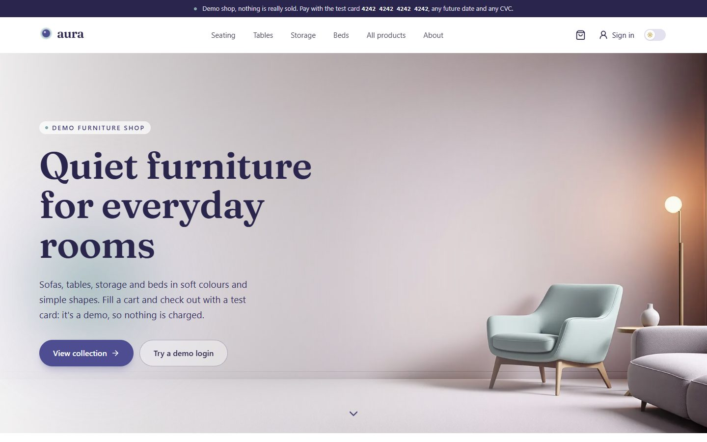
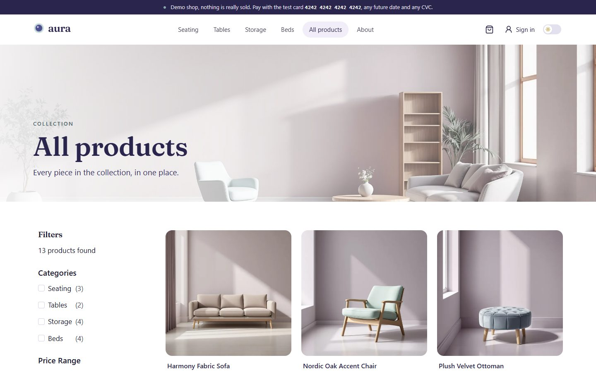
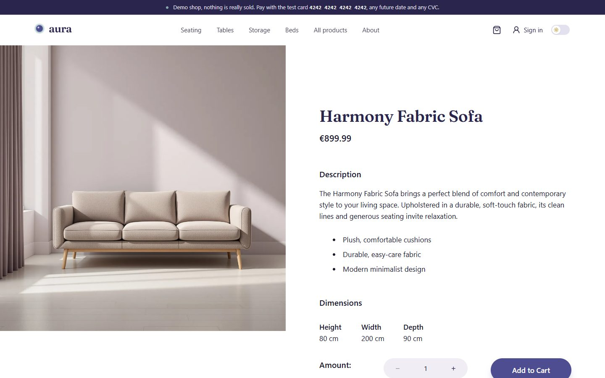
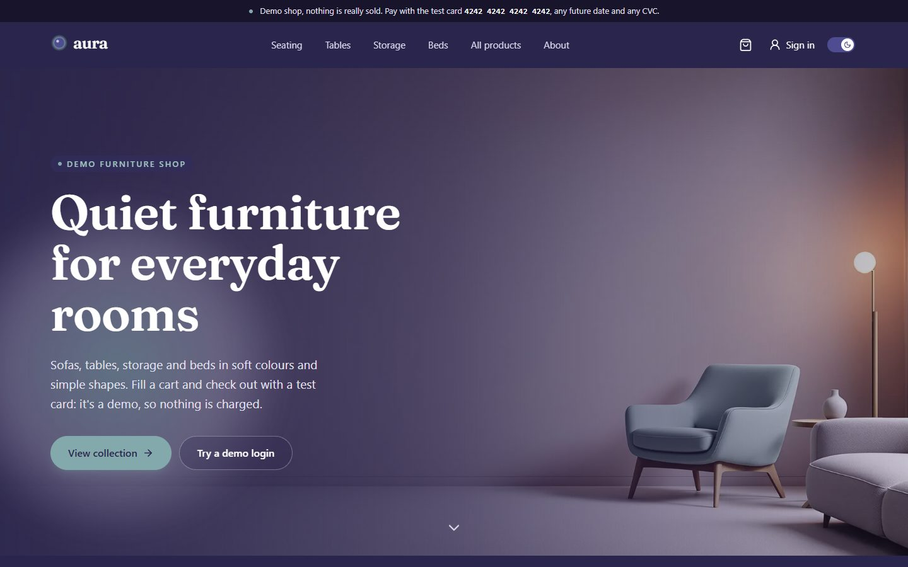
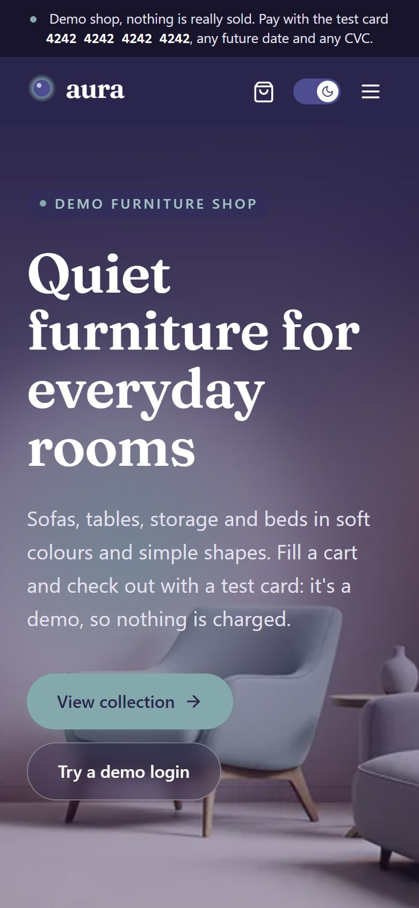
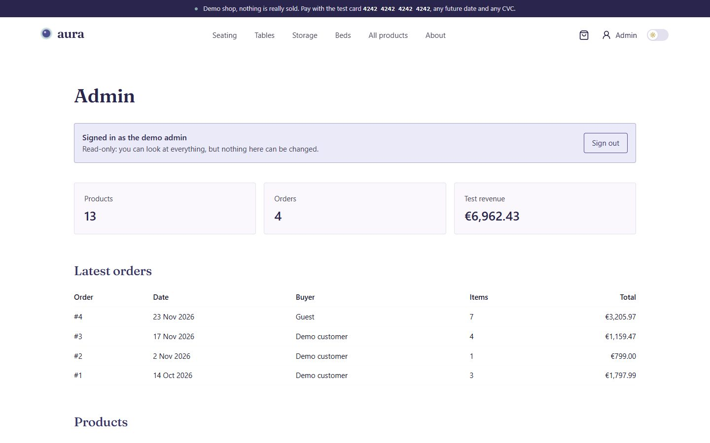

# Aura — a demo furniture shop

**Live: [aura.kiapmd.dev](https://aura.kiapmd.dev)**

A full online shop built as a portfolio piece: browse, fill a cart, pay with Stripe, see your orders, and look
around the admin side. Nothing is really sold. Stripe runs in **test mode**, so pay with the test card
`4242 4242 4242 4242`, any future date and any CVC.



## Try it

- **Shop as a guest:** pick products, change amounts in the cart, and check out with the test card.
- **One-click demo logins** on [the sign-in page](https://aura.kiapmd.dev/sign-in), no password needed:
  - *Try as a customer* shows "My orders".
  - *Try as the admin* shows counts, the latest orders and all products.

  Both are read-only, so visitors can't break the demo for each other.

| Collection with filters | Product page |
|---|---|
|  |  |

| Dark mode | Phone | Admin (read-only) |
|---|---|---|
|  |  |  |

## What's inside

- **SvelteKit 2 + Svelte 5**, server-rendered, running on Node.
- **Prisma + PostgreSQL** for products, categories and orders.
- **Stripe Checkout** for payments. Prices are looked up on the server, never trusted from the browser. Orders are
  saved by a signed Stripe webhook and by the payment-success page, and Stripe's session id stops double saves.
- **Tailwind CSS 4 + Skeleton UI**, light and dark mode with no flash on load, and a self-hosted brand font
  (Fraunces).
- Smooth page changes (View Transitions), product pictures that glide from card to page, and scroll-in effects.
  All of them turn off when the visitor asks for less motion.
- Accessibility checked with axe and Lighthouse (zero issues), and every layout tested from 360 px wide up.
- Pictures in WebP, two sizes each, so phones download the small ones.

## How it runs

Aura runs on my own server (a small VPS in Amsterdam) behind Caddy, which handles HTTPS. On every push to `master`,
GitHub Actions:

1. checks and builds the app,
2. builds a Docker image and tries it against a throwaway database,
3. sends the image to the server over SSH, which starts it and waits for it to report healthy (older images
   stay on the server, so going back is one command).

When the box starts, it updates the database tables (`prisma migrate deploy`) and fills in the products. See
`Dockerfile`, `docker/start.sh`, `compose.server.yml` and `.github/workflows/deploy.yml`.

## Run it yourself

You need Node 24, pnpm, a PostgreSQL database and a Stripe **test** key.

```sh
pnpm install
cp .env.example .env          # then fill in DATABASE_URL and STRIPEAPIKEY
pnpm prisma migrate deploy    # make the tables
pnpm prisma db seed           # add the products and sample orders
pnpm dev
```

The products point to prices in my Stripe test account. With your own key, create matching prices in Stripe and put
their ids in `prisma/seed-data.json`.

## License

MIT, see `LICENSE.txt`. The product pictures were made with AI for this demo.
